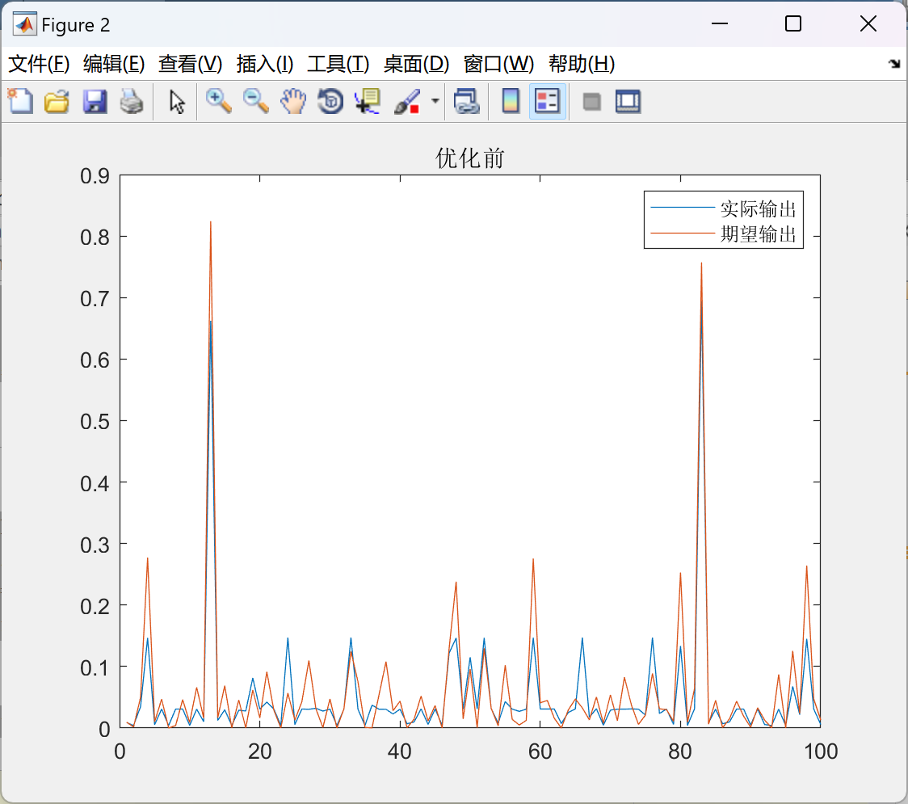
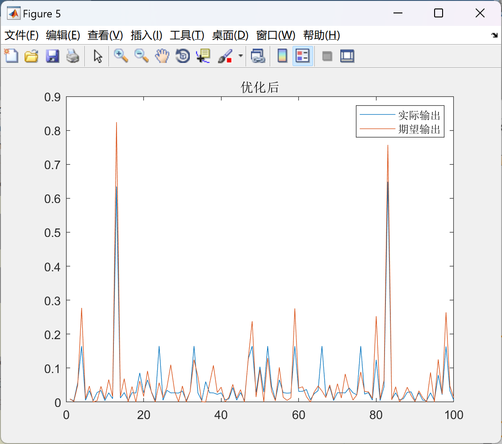

# Research on Optimizing BP Neural Network Based on Particle Swarm Algorithm (Matlab Code)

Research on Optimization of BP Neural Network Based on Particle Swarm Algorithm (Matlab Code)
\n        \n      \n        \n      function [y ,trace]=psoforbp(inputnum,hiddennum,outputnum,inputn_train,label_train,Pn_test,Tn_test)\nd=inputnum*hiddennum+hiddennum+hiddennum*outputnum+outputnum;% Optimize the weights and thresholds of each layer in bp\nN=20;                  % Number of particles in a group\nD=d;                   % Particle dimension\nT=100;                  %Maximum number of iterations\nc1=1.5;                 % Learning factor 1\nc2=1.5;                 % Learning factor 2\nw=0.8;                  % Inertia weight\n\n\nXmax=1;                % Maximum position\nXmin=-1;               % Positional minimum value\nVmax=1;                %Maximum speed\nVmin=0;               % Minimum speed\n%%\n%%%%%%%%%%%%%%%% Initialize population individuals (specify position and velocity) %%%%%%%%%%%%%%%%\nx=rand(N,D) * (Xmax-Xmin)+Xmin;\nv=rand(N,D) * (Vmax-Vmin)+Vmin;\n%%%%%%%%%%%%%%%%%% Initialize individual optimal position and value %%%%%%%%%%%%%%%%%%%\np=x;\npbest=ones(N,1);\nfor i=1:N\n    pbest(i)=fun1(x(i,:),inputnum,hiddennum,outputnum,Pn_test,Tn_test); \nend\n%%%%%%%%%%%%%%%%%%% Initialize global optimal position and value %%%%%%%%%%%%%%%%%%\ng=ones(1,D);\ngbest=inf;\nfor i=1:N\n    if(pbest(i)<gbest)\n        g=p(i,:);\n        gbest=pbest(i);\n    end\nend\n%%%%%%%%%%% Iterate according to the formula until the precision is met or the iteration count is reached %%%%%%%%%%%%\nfor i=1:T\n    i\n    for j=1:N\n        %%%%%%%%%%%%%% Update individual optimal position and value %%%%%%%%%%%%%%%%\n        if (fun1(x(j,:),inputnum,hiddennum,outputnum,Pn_test,Tn_test)) <pbest(j)\n            p(j,:)=x(j,:);\n            pbest(j)=fun1(x(j,:),inputnum,hiddennum,outputnum,Pn_test,Tn_test); \n        end\n        %%%%%%%%%%%%%%%% Update global optimal position and value %%%%%%%%%%%%%%%\n        if(pbest(j)<gbest)\n            g=p(j,:);\n            gbest=pbest(j);\n        end\n        %%%%%%%%%%%%%%%%% Update location and speed values %%%%%%%%%%%%%%%%%%%%%\n        v(j,:)=w*v(j,:)+c1*rand*(p(j,:)-x(j,:))...\n            +c2*rand*(g-x(j,:));\n        x(j,:)=x(j,:)+v(j,:);\n        %%%%%%%%%%%%%%%%%%%%%%%%%%%%%%%%%%%%%%%%%%%%%%\n        for ii=1:D\n            if (v(j,ii)>Vmax)  |  (v(j,ii)< Vmin)\n                v(j,ii)=rand * (Vmax-Vmin)+Vmin;\n            end\n            if (x(j,ii)>Xmax)  |  (x(j,ii)< Xmin)\n                x(j,ii)=rand * (Xmax-Xmin)+Xmin;\n            end\n        end\n    end\n    %%%%%%%%%%%%%%%%%%%%%%%%%%%%%%%%%%%%%%%%%%%%%%\n    gb(i,1)=gbest;%Record the fitness values of the training set\n    gb(i,2)=fun1(g,inputnum,hiddennum,outputnum,inputn_train,label_train);%Record the fitness values of the test set\n\n\nend\ntrace=gb;\ny=g;\nend\n  

## Images

<!-- PAYMENT_BLOCK -->

## Get this dataset

- Payment link (Stripe): [Buy now](https://buy.stripe.com/3cs8yP7sY87d0vu9AB)
- Payment QR code: 

<!-- /PAYMENT_BLOCK -->
